# Tazaungdaing — Myanmar's Festival of Lights

**Tazaungdaing** (တန်ဆောင်တိုင်) is held on the **full moon day of Tazaungmon**, the eighth month of the Myanmar calendar. It usually falls in November and is a national public holiday in Myanmar. It marks the end of the rainy season, and it closes the *Kathina* (Burmese *Kahtein*) season, when Buddhists offer new robes and other necessities to monks. [1][2][3]

This clock's scene is inspired by the festival: oil lamps, paper lanterns, fire balloons, a night market and floodlit pagodas.

## When is it?

| Year | Full moon of Tazaungmon |
| --- | --- |
| 2026 | 24 November |
| 2027 | 13 November |
| 2028 | 1 November |

The clock works out these dates itself from its built-in Myanmar calendar table, and shows `TAZAUNGDAING FULL MOON` on the day.

## Traditions

### Lights everywhere
Homes, monasteries and pagodas are lit with candles, oil lamps and paper lanterns, which is where the name "Festival of Lights" comes from. At Chaukhtatgyi Pagoda in Yangon, **9,999 candles** are lit as an offering to the Buddha on the full moon night, because nine is considered a lucky and auspicious number in Myanmar. [2][3]

### Fire balloons of Taunggyi
In many parts of Myanmar, paper hot-air balloons lit with candles are released on the full moon. The best-known celebration is the **Taunggyi Hot Air Balloon Festival** in the Shan State capital, which dates back to **1894**. Teams launch huge balloons made of mulberry paper. They are decorated with images of the Buddha, traditional patterns, or animals like elephants, tigers and dragons. The event draws tens of thousands of visitors. Myanmar's Ministry of Culture is working to have it listed as a UNESCO Intangible Cultural Heritage. [4][5][6]

### Matho thingan: robes woven in one night
At Yangon's **Shwedagon Pagoda** and many other pagodas, teams of weavers compete to make *matho thingan*, special yellow robes for Buddha images. They weave without stopping from evening until dawn, on the night before the full moon and on the full moon night itself, and each robe must be finished before sunrise. The custom remembers a story from the Buddha's life: his mother **Maya** spent a whole night weaving yellow robes for him when she saw he would soon renounce the world. His aunt **Gotami** carried on the tradition, offering new robes every year. [1][7][8]

### Mezali salad
On the full moon day, families pick the buds of the **Siamese cassia** (*mezali*) and cook them in a salad (*mezali phu thoke*) or a soup. [1]

### "Don't wake the crows"
On the full moon night, young men play harmless pranks on neighbours, like "stealing" things and hiding them. This custom is called *kyimano pwe*, meaning "don't wake up the crows". [1]

### Kahtein offerings
From the first waning day of Thadingyut (around October) until the full moon of Tazaungmon, people offer *Kahtein* robes and alms to monks. Tazaungdaing is the last day of the season. [1][7]

## Sources

1. Wikipedia — [Tazaungdaing festival](https://en.wikipedia.org/wiki/Tazaungdaing_festival)
2. Myanmar Ministry of Hotels & Tourism — [Tazaungdaing Festival](https://tourism.gov.mm/en/upcoming-events/tazaungdaing-festival)
3. Office Holidays — [Full Moon of Tazaungmone](https://www.officeholidays.com/holidays/myanmar/full-moon-of-tazaungmone)
4. Wikipedia — [Taunggyi Hot Air Balloon Festival](https://en.wikipedia.org/wiki/Taunggyi_Hot_Air_Balloon_Festival)
5. Myanmar Ministry of Hotels & Tourism — [Hot Air Balloon Festival](https://tourism.gov.mm/en/festivals/hot-air-balloon-festival)
6. The Star / Xinhua — [Myanmar's hot-air balloon festival blends heritage, unity with joy](https://www.thestar.com.my/aseanplus/aseanplus-news/2025/10/31/myanmar039s-hot-air-balloon-festival-blends-heritage-unity-with-joy) (2025); Al Jazeera — [Myanmar hot air balloon festival returns with a bang](https://www.aljazeera.com/gallery/2022/11/8/myanmar-hot-air-balloon-festival-returns-with-a-bang) (2022)
7. Mekong Tourism — [Kahtein Robe Weaving Competitions, Myanmar](https://mekongtourism.org/events/kahtein-robe-weaving-competitions-myanmar/)
8. The Star — [Shwedagon Pagoda filled with pilgrims for Tazaungdaing festival](https://www.thestar.com.my/aseanplus/aseanplus-news/2024/11/15/myanmar039s-shwedagon-pagoda-filled-with-pilgrims-for-famous-traditional-tazaungdaing-festival) (2024)

*The animation (`images/festival.svg`) is original artwork made for this project. It's plain SVG with CSS, so it plays on GitHub with no scripts, and it holds still if your device is set to reduce motion.*
