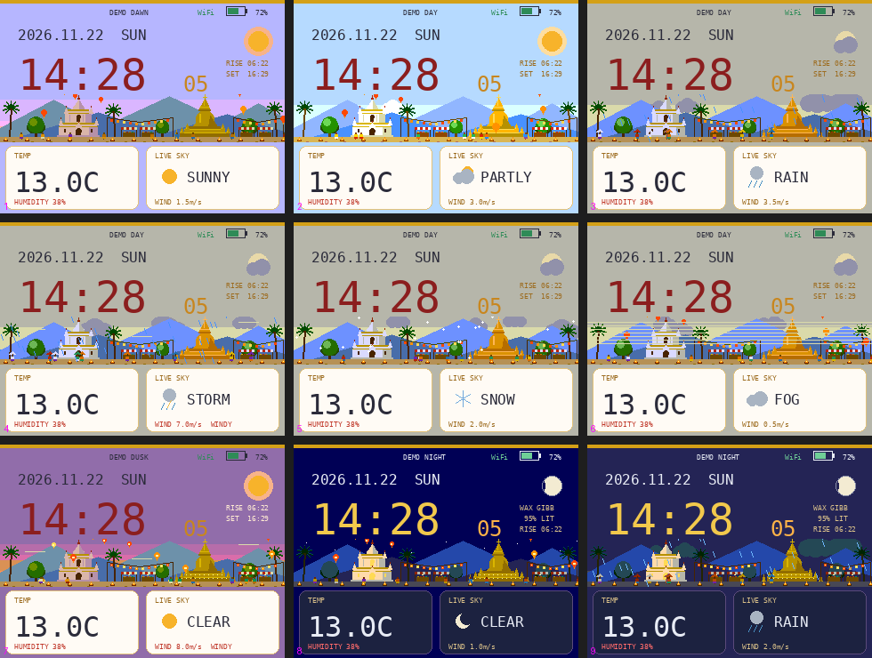

# Live Sky Clock (Tazaungdaing) — M5Stack

An animated clock for the **M5Stack Core (320x240)** running **UIFlow2 / MicroPython**, themed on the Myanmar Festival of Lights (Tazaungdaing):
Thatbyinnyu Temple and the Shwedagon Pagoda, toddy palms, a night market with lanterns, oil lamps and fire balloons.



New to the festival? Read **[Tazaungdaing — Myanmar's Festival of Lights](FESTIVAL.md)** for its traditions, dates and sources.

The scene follows the real sky at your location:

- Dawn, day, dusk and night, based on today's real sunrise and sunset
- The sun by day, and the moon in its real phase by night
- Live weather from [Open-Meteo](https://open-meteo.com/) (free, no API key): clear, cloudy, fog, drizzle, rain, snow, storm and wind
- The Myanmar calendar month or festival and the moon day (Dec 2025 – Dec 2032)

## Setup

1. Copy `secrets_example.py` to `secrets.py` and fill in your Wi-Fi details and location:
   ```python
   WIFI_SSID     = "YOUR_WIFI_SSID"
   WIFI_PASSWORD = "YOUR_WIFI_PASSWORD"
   LAT, LON = "35.6812", "139.7671"
   PLACE = "TOKYO"
   ```
2. Upload `index.py` and `secrets.py` to the device (for example with UIFlow2 or Thonny).
3. Time is shown in JST. Change `JST_OFFSET` and the `timezone` in the weather URL if you live in another time zone.

`secrets.py` is listed in `.gitignore`, so your credentials stay out of the repo.

## Buttons

| Button | Action |
| --- | --- |
| A | Go back to live mode and refresh the weather |
| B | Change brightness: bright, medium, or eco (dim, with animation off) |
| C | Demo mode: step through dawn, rain, storm, snow, fog, dusk and night |
